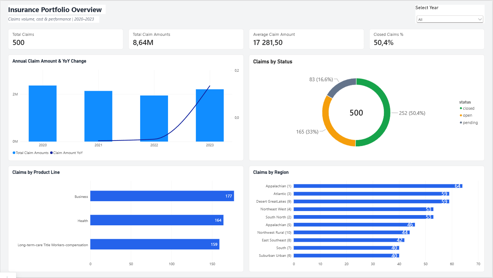
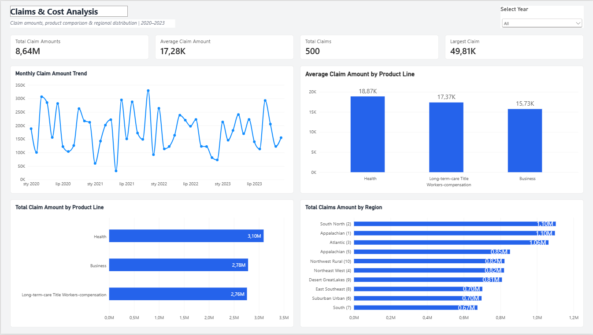
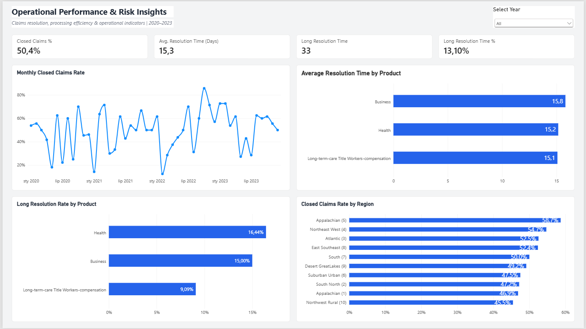

# Insurance Claims & Cost Analytics | Power BI

## Project Overview

An end-to-end Power BI analytics project focused on insurance claims, financial exposure, and operational performance.

The project demonstrates data cleaning and validation in Power Query, dimensional data modeling, DAX measure development, and interactive dashboard design.

**Tools:** Power BI Desktop, Power Query (M), DAX  
**Dataset:** Synthetic insurance claims data  
**Analysis period:** 2020–2023

## Business Objectives

The project aims to answer the following questions:

- How do insurance claim volumes and amounts change over time?
- Which insurance products and regions generate the highest claim amounts?
- How do average claim amounts differ across product lines?
- What percentage of claims are closed, open, or pending?
- How does claims processing time vary across products and regions?
- Which products have the highest proportion of claims taking more than 20 days to resolve?

## Dataset

Source: [Claims Warehouse — Database Sample](https://databasesample.com/datasets/claims-warehouse)

The original dataset contains five tables:

| Table | Records | Description |
|---|---:|---|
| claims | 500 | Individual insurance claims |
| policies | 200 | Insurance policy details |
| product_lines | 3 | Insurance product categories |
| regions | 10 | Regional information |
| dates | 365 | Original date reference table |

A new calendar table was generated for reporting purposes.

## Data Preparation & Quality Assessment

Data preparation was performed entirely in Power Query.

Key activities included:

- Data type validation and locale-aware decimal conversion.
- Column profiling and logical consistency checks.
- Identification of invalid policy periods.
- Validation of calendar attributes against actual dates.
- Referential integrity checks using Left Anti Joins.
- Verification of claim dates against date dimension keys.
- Creation of an independent reporting calendar.
- Separation of audit queries from report tables.

### Major Data Quality Findings

| Issue | Affected Records |
|---|---:|
| Policies with end dates earlier than start dates | 104 / 200 (52.0%) |
| Incorrect month values in original date table | 335 / 365 (91.8%) |
| Incorrect year values | 271 / 365 (74.2%) |
| Incorrect weekday values | 313 / 365 (85.8%) |
| Claim dates inconsistent with referenced date IDs | 499 / 500 (99.8%) |

All four foreign-key integrity checks returned zero unmatched claims.

Due to date inconsistencies, the reporting calendar was generated from `claims[claim_date]`, which was selected as the authoritative date field for analysis. This is an explicit modeling assumption, not an independently verified correction of the source data.

Duplicate region names were also identified and handled using distinct region identifiers.

## Data Model

The Power BI model follows a star-schema approach.

**Fact table:** `claims`

**Dimension tables:**

- `policies`
- `product_lines`
- `regions`
- `DimCalendar`

Relationships use one-to-many cardinality and single-direction filtering from dimensions to the fact table.

The reporting calendar is connected through `DimCalendar[Date]` and `claims[claim_date]`.

## DAX Measures

Key measures include:

**Claims and Financial Analytics**
- Total Claims
- Total Claim Amount
- Average Claim Amount
- Largest Claim
- Claim Amount Previous Year
- Claim Amount YoY %

**Claims Status**
- Closed Claims
- Open Claims
- Pending Claims
- Closed Claims %
- Open Claims %
- Pending Claims %

**Operational Performance**
- Average Resolution Time
- Long Resolution Claims
- Long Resolution Rate %

The measures use DAX functions such as `CALCULATE`, `DIVIDE`, `COUNTROWS`, `SUM`, `AVERAGE`, `MAX`, `IF`, and `SAMEPERIODLASTYEAR`.

## Dashboards

### 1. Insurance Portfolio Overview



An executive overview featuring claim volumes, total claim amounts, annual trends, status distribution, product categories, and regional comparisons.

### 2. Claims & Cost Analysis



A financial analysis page comparing total and average claim amounts, maximum claim size, monthly trends, product lines, and regions.

### 3. Operational Performance & Risk Insights



An operational dashboard focused on closed-claim rates, average resolution times, long-duration cases, and comparisons across products and regions.

All three dashboard pages support interactive filtering, including synchronized year slicers.

## Key Findings

- **500 claims** were analyzed, with a total reported claim amount of approximately **8.64 million** monetary units.
- The average claim amount was **17,281.50**.
- **252 claims (50.4%)** were closed.
- The average resolution time among closed claims was **15.3 days**.
- **33 closed claims (13.1%)** had a resolution time exceeding 20 days.
- Health generated the highest aggregate claim amount, approximately **3.10 million**, and the highest average claim amount among the three products.
- Business recorded the highest number of claims, at **177**.
- Data-quality checks revealed substantial calendar and policy-date inconsistencies.

## Limitations

This project uses synthetic data and is intended for demonstration and portfolio purposes.

Important limitations:

- The dataset does not provide insurance premium revenue, so loss ratios and underwriting profitability cannot be calculated reliably.
- Claim amounts should not automatically be interpreted as settled or paid amounts.
- Some source dates and descriptive fields are inconsistent.
- The original `date_id` relationships were not suitable for time-based reporting.
- The 20-day resolution threshold is an analytical assumption, not an official service-level agreement.
- Monthly trends may be volatile due to the limited number of records.
- No conclusions about actual insurance companies or real-world populations should be drawn from this dataset.

## Repository Structure

```text
insurance-claims-cost-analytics/
├── data/
│   ├── claims.csv
│   ├── policies.csv
│   ├── product_lines.csv
│   ├── regions.csv
│   └── dates.csv
├── screenshots/
│   ├── 01_portfolio_overview.png
│   ├── 02_claims_cost_analysis.png
│   └── 03_operational_performance.png
├── Insurance Claims & Cost Analytics.pbix
└── README.md
```

## Skills Demonstrated

**Power Query:** ETL, data profiling, custom M expressions, merge queries, data quality validation.

**Data Modeling:** Star schema, dimension tables, relationship design, filter propagation.

**DAX:** Measures, filter context, time intelligence, ratios, conditional logic.

**Power BI:** Interactive dashboards, cross-filtering, synchronized slicers, KPI reporting, data visualization.

**Business Analysis:** Claims analytics, operational performance assessment, data quality reporting, interpretation of analytical limitations.
